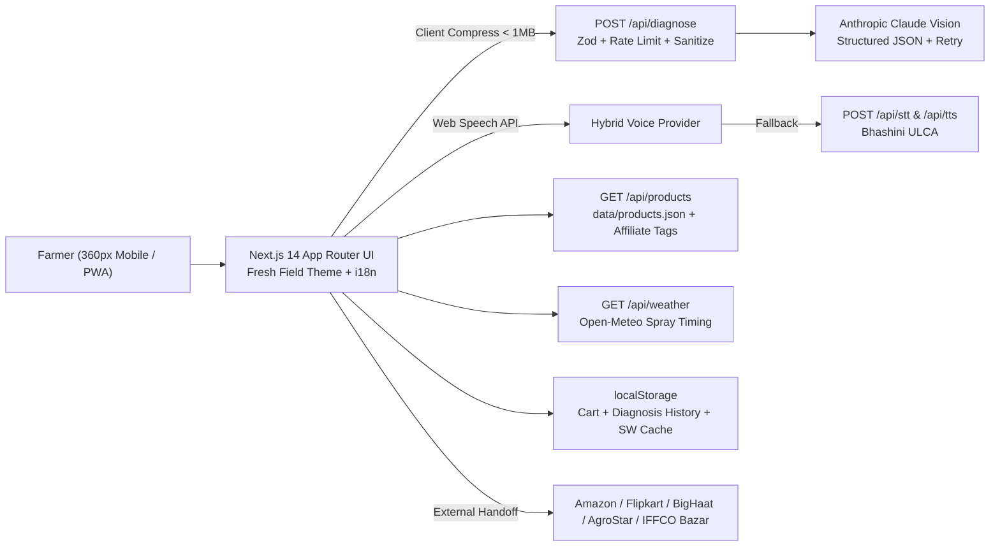

# KisanMitra AI — Multilingual Crop Doctor & Farm Assistant

> **Pitch:** Small and marginal farmers in India lose up to 15–25% of their yield each season because plant diseases and pests go undiagnosed until it is too late, while expert agronomy advice is often distant, costly, or unavailable in their mother tongue. **KisanMitra AI** turns any budget Android smartphone into a voice-first, icon-first crop doctor across all 22 scheduled Indian languages + English: a farmer snaps a leaf photo or speaks in their own language, receives a Class-6-readable diagnosis with organic-first treatment steps, mandatory safety warnings, and direct price-compared purchase links to trusted Indian agri stores (Amazon India, Flipkart, BigHaat, AgroStar, IFFCO Bazar) without us ever handling their money. Using multimodal vision AI with structured safety guardrails and hybrid Web Speech + Bhashini voice, KisanMitra bridges the last-mile agronomy gap today—with a roadmap toward partner-store in-app checkout, offline on-device leaf models, WhatsApp bot access, and direct KVK expert escalation.

---

## Architecture



---

## Language Support (All 22 Scheduled Languages + English)

KisanMitra AI supports all 22 scheduled Indian languages plus English (`hi`, `bn`, `te`, `mr`, `ta`, `ur`, `gu`, `kn`, `or`, `ml`, `pa`, `as`, `mai`, `sat`, `ks`, `ne`, `sd`, `kok`, `doi`, `mni`, `brx`, `sa`, `en`):
- **Pre-translated UI JSON dictionaries (`/i18n/*.json`):** English (`en`) + 10 major Indian languages (`hi`, `bn`, `te`, `mr`, `ta`, `gu`, `kn`, `ml`, `pa`, `or`).
- **Auto-detect + AI native-script replies:** Other scheduled languages fall back to English UI labels while AI diagnosis, follow-up questions, treatment steps, and safety rules are generated directly in the selected language.
- **Honest quality note:** Accuracy and voice quality are **strongest in Hindi, Bengali, Telugu, Marathi, Tamil, Gujarati, Kannada, Malayalam, Punjabi, and Odia**, and **weaker for low-resource languages such as Santali, Bodo, Dogri, and Kashmiri** (where browser Web Speech TTS/STT often requires Bhashini ULCA configuration).

---

## Folder Structure

- `app/` — Next.js 14 App Router pages & serverless API routes (`/api/diagnose`, `/api/translate`, `/api/stt`, `/api/tts`, `/api/products`, `/api/weather`, `/api/mandi`, `/api/health`)
- `components/` — Fresh Field UI components (`LanguagePicker`, `HomeScreen`, `ScanScreen`, `ResultScreen`, `ProductDetailSheet`, `CartScreen`, `HistoryScreen`, `SchemesScreen`)
- `lib/ai/` — Anthropic Claude client, Zod schemas, safety/prompt-injection guarded `systemPrompt.ts`
- `lib/voice/` — Swappable `VoiceProvider` (Web Speech API + Bhashini ULCA fallback)
- `lib/products/` — Product matcher (organic-first sorting), affiliate link builder, store cart grouper
- `lib/i18n/` — 23-language registry, script auto-detector, React i18n & theme/font-scale context
- `lib/security/` — Per-IP rate limiter, input sanitizer, image mime/size validator
- `data/` — `products.json` (24 curated farm inputs with real store search URLs) & `schemes.json`
- `i18n/` — UI translation JSON files
- `public/` — `manifest.json`, `sw.js`, SVG icons & product artwork
- `tests/` — Vitest unit & API smoke tests

---

## Setup & Local Development

### 1. Environment Variables
Copy `.env.example` to `.env.local` and configure:

| Variable | Required | Purpose |
|---|---|---|
| `ANTHROPIC_API_KEY` | Yes (for live AI) | Claude Vision diagnosis & translation (falls back to safe demo guidance if omitted) |
| `CLAUDE_MODEL` | Recommended | e.g. `claude-sonnet-4-20250514` |
| `BHASHINI_USER_ID` | Optional | Bhashini ULCA user ID for regional STT/TTS fallback |
| `BHASHINI_API_KEY` | Optional | Bhashini ULCA API key |
| `BHASHINI_PIPELINE_ID` | Optional | Bhashini pipeline ID |
| `AFFILIATE_TAG_AMAZON` | Optional | Appended as `?tag=...` on Amazon India links |
| `AFFILIATE_TAG_FLIPKART` | Optional | Appended as `?affid=...` on Flipkart links |
| `NEXT_PUBLIC_APP_URL` | Yes | Deployed origin for CORS headers (e.g. `http://localhost:3000`) |
| `SUPABASE_URL` / `SUPABASE_ANON_KEY` | Optional | Reserved for future cloud history/image storage |
| `DATA_GOV_IN_API_KEY` | Optional | Live AGMARKNET mandi rates (falls back to reference rates) |

### 2. Run Locally

```bash
npm install
cp .env.example .env.local
npm run dev
```

Open `http://localhost:3000`.

### 3. Verify Quality Checks

```bash
npm run lint
npm run typecheck
npm test
npm run build
```

---

## Deployment

### Option A: Vercel (Primary)
1. Push this repository to GitHub.
2. In **Vercel Dashboard → Add New Project**, import the GitHub repo.
3. Set Environment Variables (`ANTHROPIC_API_KEY`, `CLAUDE_MODEL`, `NEXT_PUBLIC_APP_URL`, optional Bhashini & Affiliate tags).
4. Enable automatic deployments on `main` (Vercel creates Preview URLs automatically for PRs).
5. **Custom Domain & HTTPS:** Go to **Project Settings → Domains**, add your domain (e.g. `kisanmitra.in`), point your DNS `A` / `CNAME` records as instructed; Vercel provisions Let's Encrypt HTTPS automatically.

### Option B: Docker / Render / Railway / VPS
```bash
docker compose up --build -d
```
Or build the multi-stage image directly:
```bash
docker build -t kisanmitra-ai .
docker run -p 3000:3000 --env-file .env.local kisanmitra-ai
```
Place behind Nginx/Caddy for automatic Let's Encrypt HTTPS on a VPS.

### Post-Deploy Verification Checklist
- [ ] Test **Camera / Photo upload** and verify client compression stays `< 1 MB`
- [ ] Test **Microphone voice input** and **Listen (TTS)** button on Android Chrome
- [ ] Verify **PWA Install** prompt & offline mode banner (turn on Airplane mode and open History/Cart)
- [ ] Throttle network to **Slow 3G** in Chrome DevTools and check first-load speed
- [ ] Test the **5 main languages** (Hindi, Marathi, Tamil, Telugu, Bengali) end-to-end

---

## Manual Test Checklist (5 Core Languages)

1. **Hindi (`hi`)**: Select `हिन्दी`, type `"गेहूं के पत्तों पर पीली धारियां हैं"`, verify Hindi diagnosis, safety box, and audio readout.
2. **Bengali (`bn`)**: Select `বাংলা`, type `"টমেটো পাতায় বাদামী দাগ"`, verify Bengali response and organic-first products.
3. **Telugu (`te`)**: Select `తెలుగు`, select Chilli crop chip, verify Telugu steps and KVK card.
4. **Marathi (`mr`)**: Select `मराठी`, type `"कापसावर गुलाबी बोंडअळी"`, verify Marathi plan and pheromone trap recommendation.
5. **Tamil (`ta`)**: Select `தமிழ்`, tap Listen button, check product price comparison & Cart store grouping.

---

## 60-Second Hackathon Demo Script & 5 Sample Inputs

### 60-Second Demo Script
1. **0:00–0:10:** Open KisanMitra AI on mobile view (`360px`). Point out the native-script language grid and tap **हिन्दी**.
2. **0:10–0:22:** Show the **Fresh Field** Home screen, tap **Spray Weather Check**, then tap **Scan your crop**.
3. **0:22–0:36:** Upload a tomato leaf photo (show automatic `< 1 MB` compression), select the **Tomato** crop chip, and tap the **80px Voice Mic** (or type symptoms). Tap **Diagnose Crop** to show the growing sprout loader with spoken audio.
4. **0:36–0:50:** Walk through the **Result screen**: Confidence Ring, Severity Meter, Organic → Biological → Chemical timeline, red Safety box (`Always check the product label`), and tap **Listen**.
5. **0:50–1:00:** Add **Neem Oil** and **Trichoderma** to the Cart, open **Cart** to show store-grouped handoff (`"We never handle your money"`) and the **1800-180-1551 KVK** helpline.

### 5 Sample Test Inputs
1. **Wheat Yellow Rust (Hindi Voice/Text):** Crop=`wheat`, Text=`"गेहूं के पत्तों पर पीली धारियां और हाथ पर पीला पाउडर लग रहा है"`
2. **Tomato Early Blight (Photo + English):** Crop=`tomato`, Photo=leaf with concentric brown rings, Text=`"Lower leaves turning yellow with brown spots"`
3. **Cotton Pink Bollworm (Marathi Voice):** Crop=`cotton`, Text=`"कापसाची बोंडे आतून सडत आहेत आणि गुलाबी अळी दिसते"`
4. **Rice Leaf Blast / Brown Spot (Bengali Text):** Crop=`rice`, Text=`"ধানের পাতায় চোখ আকৃতির বাদামী দাগ দেখা যাচ্ছে"`
5. **Ambiguous Input Triggering Follow-ups (Tamil):** Crop=`chilli`, Text=`"இலை சுருண்டுள்ளது"` (triggers 1–3 tappable follow-up questions to distinguish thrips vs mites vs leaf curl virus)

---

## Known Limitations & Roadmap

- **Current limitations:** Store prices are approximate static references (`check store for latest price`); exact product deep-links fall back to store search URLs when SKU links vary; low-resource scheduled languages have weaker STT/TTS quality without custom Bhashini pipelines; history & cart are stored locally in `localStorage`.
- **Roadmap:**
  1. Direct store partner APIs for live pricing and seamless in-app checkout
  2. Lightweight offline on-device leaf disease classifier (TensorFlow.js / ONNX) for zero-connectivity villages
  3. WhatsApp Bot integration for voice-note + photo diagnosis without installing an app
  4. Expanded regional crop varieties and direct two-way video/callback escalation to local KVK agronomists
